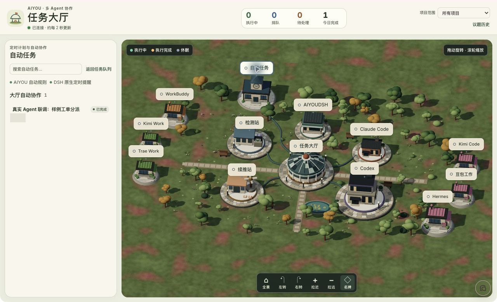
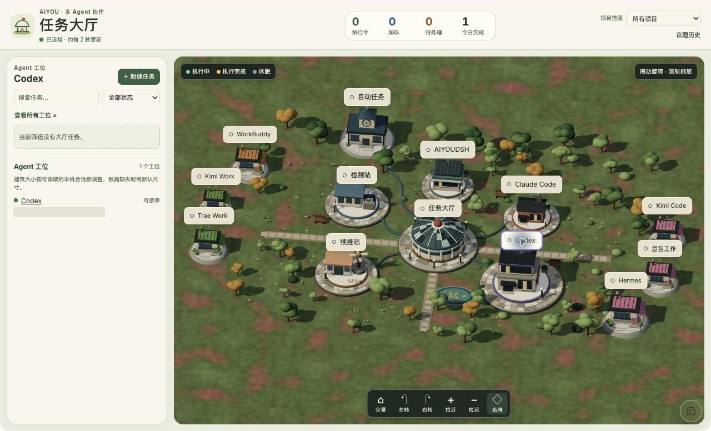
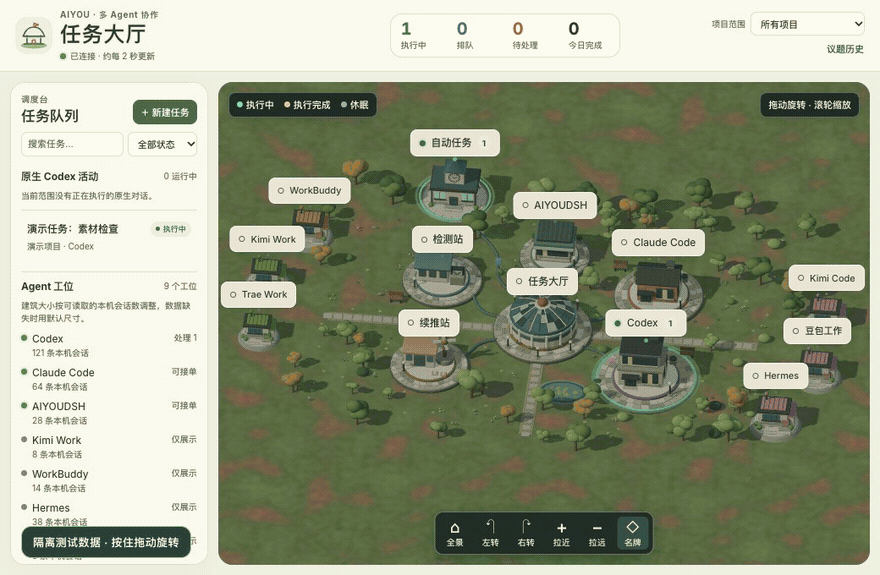
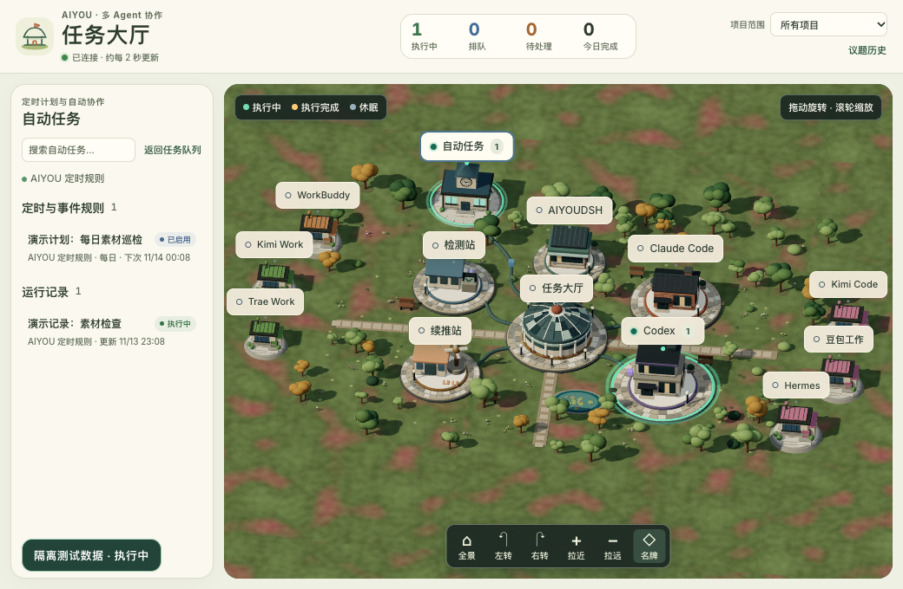
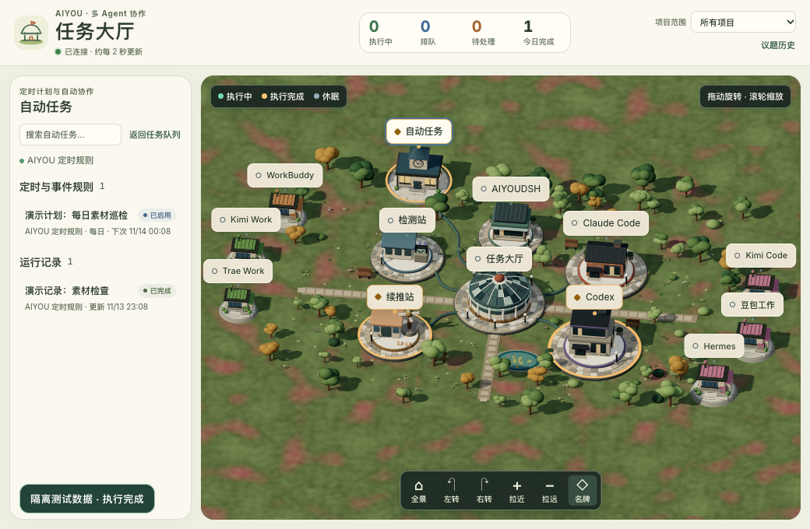
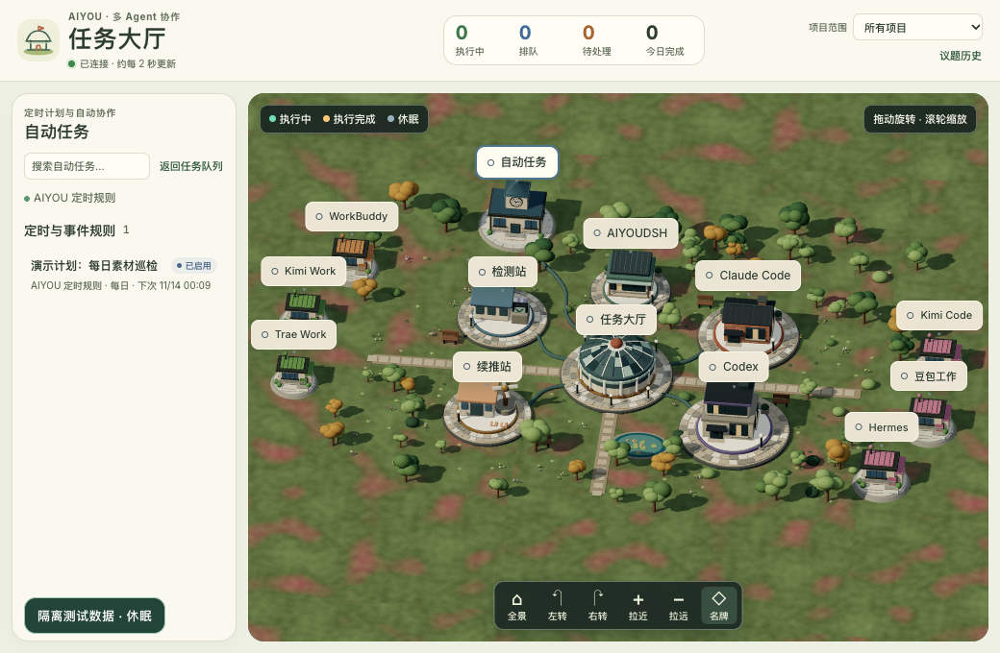

# AIYOU 3D 任务大厅｜双端更新

AIYOUCODEX 与 AIYOUDSH 的「任务大厅」把分散的任务队列、自动化和 Agent 协作汇到一张 3D 地图。打开侧边栏的「任务大厅」即可进入；按住鼠标左键拖动旋转，滚轮缩放，点击「全景」复位。

- **自动任务钟楼**：汇总可读取的定时计划、事件规则、运行记录和大厅自动协作。
- **Agent 工位**：仅为本机检测到的 Agent 显示工位；建筑大小参考可读的本机会话数量。仅展示的工位与可接单的工位分开标记。
- **任务流转**：从领取、交接到检测和续推，都能查看当前阶段。薄荷绿表示执行中，金色表示近期执行完成，灰蓝色表示休眠。

## DSH 桌面实机截图

以下画面取自本机 AIYOUDSH 桌面端，已裁掉宿主对话区域。

自动任务钟楼（左侧展示自动任务来源及协作记录）：

Agent 工位（选中 Codex，已遮盖本机会话统计细节）：

## GIF 与三种状态

使用实际 WebGL 界面和隔离任务数据录制。动图依次展示左键拖动旋转、滚轮缩放、全景复位，以及同一工位从执行中到执行完成再回到休眠。下方三张状态图均来自该演示，不代表正式任务运行。

| 执行中 | 执行完成 | 休眠 |
| --- | --- | --- |
|  |  |  |

## 验证范围

本机曾用一条合成工单跑通 Codex 领取、Claude Code 交接、AIYOUDSH 检测和 Codex 续推，最终在 DSH 桌面大厅读到完成记录。GIF 使用独立测试数据复现视觉状态；没有为录制重新提交模型任务。

与更强的你，一起构建可能。
